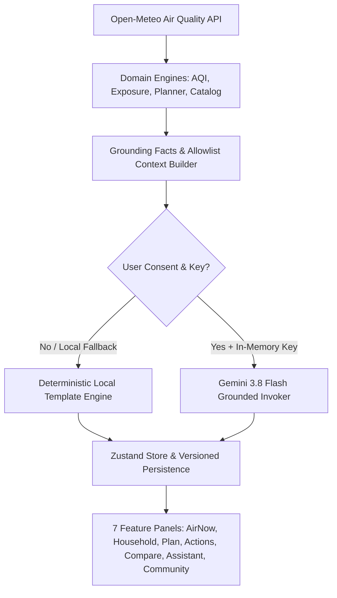

# Clearbreath: GenAI Urban Air Quality Assistant

Clearbreath is a GenAI-powered urban air quality advisory assistant designed to help families and communities navigate severe winter smog episodes. Live app: [https://clearbreath-omega.vercel.app/](https://clearbreath-omega.vercel.app/) (GitHub Pages mirror: [https://akshayjadhav237237-cmd.github.io/clearbreath/](https://akshayjadhav237237-cmd.github.io/clearbreath/)).

## Vertical & Persona

- **Vertical**: Family and community air-quality planning during seasonal winter smog episodes.
- **Default Persona**: Codified in `src/config/persona.ts` as `DEFAULT_HOUSEHOLD_PERSONA` (`Sharma Family (Delhi-NCR)`): `adult` (`respiratoryCondition: false`), `child` (`respiratoryCondition: true`), and `older` (`respiratoryCondition: true`), in a 90 m² apartment (`average` sealing, 250 m³/h CADR purifier, kitchen exhaust, `png` cooking fuel), 12 km / 35 min `metro` commute, 45 min/day outdoors, and ₹5,000 monthly mitigation budget.

## Problem Map

| Challenge                    | Solution Module                                     | Verification                                                                       |
| :--------------------------- | :-------------------------------------------------- | :--------------------------------------------------------------------------------- |
| Severe PM2.5 / PM10 Spikes   | Diurnal 24-hr planner & ventilation windows         | `tests/domain/planner/planner.test.ts`                                             |
| Inhaled Particulate Toxicity | Physical dose engine (`V_E × C_in × t`)             | `tests/domain/exposure/dose.test.ts`                                               |
| Indoor Infiltration Controls | Mass-balance infiltration and DIY air cleaner model | `tests/domain/exposure/exposure.test.ts`                                           |
| Transit Smog Exposure        | Low-emission commute ranker & CO2e calculator       | `tests/domain/recommend/recommend.test.ts`, `tests/domain/actions/actions.test.ts` |
| Community Awareness          | WhatsApp & RWA broadcast copy generator             | `tests/features/community.test.tsx`                                                |
| Grounding & Data Controls    | Grounding fact injector & allowlist scrubber        | `tests/ai/guard/guard.test.ts`                                                     |

## Architecture & Data Flow

India CPCB NAQI breakpoints and advisories execute in the browser from static domain tables, while Open-Meteo supplies hourly PM2.5 and PM10 readings (with deterministic `SampleProvider` fallback on fetch error). Live `gemini-3.8-flash` API calls against Google's endpoint remain unverified without a live API key; `LocalProvider` handles deterministic responses when consent or key is absent.

## Data Egress & Allowlist Disclosure

Cloud AI is optional and domain calculations run in the browser; outbound browser requests go only to Open-Meteo and Gemini (Open-Meteo gets the selected city's coordinates; Gemini gets only the allowlisted fields, only after consent and key).

<!-- privacy:start -->

| Field              | Purpose                                                                        | Example                                 |
| ------------------ | ------------------------------------------------------------------------------ | --------------------------------------- |
| `city`             | Selects local climatological and baseline AQI parameters.                      | `Delhi`                                 |
| `aqiCategory`      | Directs severity and urgency of outdoor activity advisories.                   | `severe`                                |
| `aqiValue`         | Provides ambient diurnal particulate index.                                    | `430`                                   |
| `sensitivityLevel` | Calibrates vulnerability threshold for elder and child guidance.               | `high`                                  |
| `ageGroupsPresent` | Ensures tailored protective guidance without exposing member identities.       | `["child", "older"]`                    |
| `homeType`         | Informs dwelling infiltration estimates.                                       | `apartment`                             |
| `sealing`          | Determines building envelope air exchange rate.                                | `average`                               |
| `cookingFuel`      | Evaluates indoor combustion particulate sources.                               | `png`                                   |
| `commuteMode`      | Identifies transit exposure and carbon mitigation opportunities.               | `metro`                                 |
| `budgetBand`       | Filters viable intervention actions without revealing financial details.       | `medium`                                |
| `language`         | Instructs response language preference.                                        | `en`                                    |
| `facts`            | Supplies verified mathematical and catalog evidence to prevent hallucinations. | `[{ id: "act-indoor-seal-gaps", ... }]` |
| `question`         | Transmits sanitized question text only when user submits a query.              | `Should we run the purifier tonight?`   |

<!-- privacy:end -->

## Quality & Verification Matrix

| Criterion                | Implementation & Measured Outcome                                                                                          | Verified Artifacts                                        |
| :----------------------- | :------------------------------------------------------------------------------------------------------------------------- | :-------------------------------------------------------- |
| **Code Quality**         | 200 lines/file max, 60 lines/fn (`.ts`) / 90 lines/fn (`.tsx`), 0 `any`, 0 `!`, 0 clones (`110` files analyzed)            | `npm run check`, `npm run dup`                            |
| **Problem Alignment**    | CPCB NAQI breakpoints, ASHRAE/EPA mass-balance infiltration, EPA dose calculations                                         | `src/domain/`, `src/features/`                            |
| **Egress & Headers**     | Allowlist egress, strict CSP & `6/6` Vercel HTTP headers, memory-only API key isolation                                    | `e2e/privacy.spec.ts`, `tests/ai/privacy/privacy.test.ts` |
| **Efficiency**           | Initial JS `70.48 KiB` gzip (`72.18 kB` SI) vs `75 KiB` budget; CSS `5.41 KiB` (`5.54 kB` SI) vs `20 KiB`; browser engines | `scripts/check-bundle.mjs`                                |
| **Testing**              | `61` test files (`338` unit tests passing), `18` Chromium E2E specs across `4` files; `94.47%` stmts / `92.43%` branches   | `npm run check`, `npm run e2e`                            |
| **Accessibility & Live** | `0` axe-core violations across `10` states / `33` live scans (`2026-11-26 UTC`); Mobile Lighthouse `100 / 100 / 100 / 100` | `e2e/a11y.spec.ts`, `docs/VERIFICATION.md`                |

## Commands

- `npm run dev`: Local Vite development server.
- `npm run build`: Production build into `dist/`.
- `npm run check`: Complete quality verification (`typecheck`, `lint`, `format:check`, `test:coverage`, `knip`, `dup`, `build`, `bundle:check`).
- `npm run e2e`: Real Chromium end-to-end tests via Playwright (`18` specs).

## Attribution & License

- Air quality data powered by [Open-Meteo](https://open-meteo.com/) under [CC BY 4.0](https://creativecommons.org/licenses/by/4.0/).
- Breakpoints and health advisories based on India CPCB National Air Quality Index.
- Licensed under the [MIT License](LICENSE).
